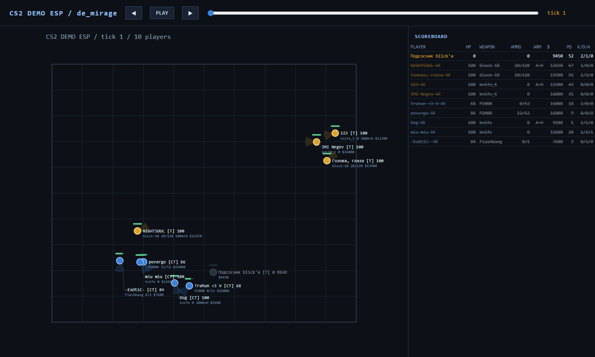

# CS2ESP0711

**Counter-Strike 2 demo-file entity parser and radar ESP overlay — written from scratch in C++20.**

`cs2demo_esp` reads a CS2 demo capture (`.dem`), reconstructs the full entity
graph, resolves every player's position, loadout and match state, and renders
it as an animated radar with a live scoreboard. It is a complete,
dependency-free reimplementation of the demo format — no game files, no
external libraries, no runtime dependencies beyond the Windows C++ runtime.



---

## Scope — read this first

This is an **offline demo-analysis tool**.

| It does | It does not |
|---|---|
| Parse a `.dem` file from disk | Read the memory of a running game |
| Reconstruct entities and world coordinates | Inject code into any process |
| Render a radar / scoreboard of the recorded match | Talk to Valve's servers |
| Export per-tick player state for analysis | Attach to a live session |

There is no live-process component, no injection, and no network code in this
repository. The output is an HTML/SVG artifact describing a match that was
already recorded. Use it for coaching, demo review, statistics and
reverse-engineering research.

`Counter-Strike 2` is a trademark of Valve Corporation. This project is not
affiliated with or endorsed by Valve.

---

## Features

* **Full demo container parsing** — `PBDEMS2\0` filestamp, varint-framed
  commands, `DEM_IsCompressed` handling.
* **Source 2 net messages** — `CSVCMsg_SendTables`, `CSVCMsg_ClassInfo`,
  `CSVCMsg_SendProtobuf`, `CSVCMsg_PacketEntities`,
  `CSVCMsg_FlattenedSerializer`, `CSVCMsg_StringTables`.
* **Field-path Huffman codec** — all 40 `FieldOp` variants with the
  comparator tie-break rule (lowest weight first; equal weights resolve to the
  larger op index), driven by an 8-bit lookup table.
* **Entity delta reconstruction** — created / updated / deleted entity
  lifecycle, with per-entity bit lengths from `serialized_entities` used to
  snap the bit reader back into alignment.
* **World coordinates** — `cell * 512 - 16384 + offset` reconstruction
  (`CELL_BITS = 512`, `MAX_COORD = 16384`) for X, Y and Z.
* **Per-player state** — position, yaw, health, armour, helmet, weapon,
  magazine ammo, reserve ammo, money, ping, K/D/A, scoped / defusing / ducked
  flags, alive-dead state.
* **Weapon resolution** — econ item-definition index mapped to the real
  display name (74 weapons, mirroring the reference implementation's map).
* **Radar renderer** — SVG radar with team colours, view cones, health bars,
  collision-aware label placement and leader lines.
* **Animated player** — a self-contained HTML file with a frame scrubber and
  a live scoreboard (HP, weapon, ammo, armour, money, ping, K/D/A).
* **CSV export** — one row per player per sampled tick, for diffing against
  another parser.
* **Verified** — every extracted field is cross-checked against
  [`demoparser2`](https://pypi.org/project/demoparser2/) (the Python binding of
  the Rust reference parser). See [Validation](#validation).

---

## Quick start

### Requirements

* Windows 10 / 11
* Visual Studio 2022 or newer with the **C++ desktop development** workload
  (the project targets C++20)
* Windows SDK 10.0.26100.0 or any compatible 10.x SDK

### Build

```bat
build.bat
```

The script drives `cl.exe` directly with hand-written `INCLUDE` / `LIB` / `PATH`
entries, so it works in environments where `vcvars64.bat` is unavailable
(it needs `reg.exe`). Adjust the two path variables at the top of the script if
your Visual Studio install lives elsewhere:

```bat
set "VCTOOLS=C:/Program Files/Microsoft Visual Studio/18/Community/VC/Tools/MSVC/14.51.36231"
set "SDK=C:/Program Files (x86)/Windows Kits/10"
set "SDKVER=10.0.26100.0"
```

Output: `out/cs2demo_esp.exe` — a single static binary, no runtime dependencies.

### Getting a demo file

Demo captures are Valve assets and are **not** redistributed here. Produce your
own with:

```
Console:  mp_demo_writefile 1
Config:   sv_demo_writefile 1
```

Then drop the resulting `.dem` anywhere on disk. (The upstream reference
project ships a `test_demo.dem` that works with this tool as well.)

### Run

```bat
out\cs2demo_esp.exe esp path\to\your.dem out\radar.html 4 out\radar.svg
```

Open `out\radar.html` in any browser. No server, no assets, no network — the
file is entirely self-contained.

---

## CLI reference

```
cs2demo_esp schema <demo.dem>
cs2demo_esp dump   <demo.dem> [class-filter] [max-entities]
cs2demo_esp esp    <demo.dem> <out.html> [tick-stride] [tick.svg]
cs2demo_esp csv    <demo.dem> <out.csv> [tick-stride]
```

### `schema` — inspect the serializers

```bat
out\cs2demo_esp.exe schema demo.dem
```

Lists every serializer the demo's `SendTables` packet declares, with its field
count. Useful for discovering what a given demo actually carries.

### `dump` — raw entity dump

```bat
out\cs2demo_esp.exe dump demo.dem CCSPlayerController 1
```

Prints the decoded fields of the first N entities whose class name contains
the filter. This is the lowest-level debugging surface — it is how the
prop paths in this README were reverse-engineered.

```
tick=1 entity[1] class=CCSPlayerController serial=723 fields=510
    m_iTeamNum = 3
    m_iszPlayerName = "Partridge"
    m_pActionTrackingServices.m_matchStats.m_iKills = 2
    ...
```

### `esp` — radar + scoreboard

```bat
out\cs2demo_esp.exe esp demo.dem radar.html 4 radar.svg
```

* `tick-stride` — sample every Nth tick (default `8`). Lower = smoother and
  more accurate, at the cost of a larger HTML file.
* `tick.svg` — optional path for a standalone SVG of the **first** sampled
  frame.

The HTML output contains:

* a frame scrubber with play / pause / step,
* the radar map with team-coloured markers, view cones, health bars,
  weapon / ammo / armour / money detail lines and de-collided labels,
* a **SCOREBOARD** panel listing every player with HP, weapon, ammo, armour,
  money, ping and K/D/A; dead players are dimmed and marked ☠.

### `csv` — machine-readable state dump

```bat
out\cs2demo_esp.exe csv demo.dem stats.csv 1
```

One row per player per sampled tick, 23 columns:

```
tick,steamid,name,team,health,alive,x,y,z,yaw,weapon,clip,reserve,armor,
helmet,money,ping,kills,deaths,assists,scoped,defusing,ducked
```

```csv
1,76561197966986733,Partridge,3,100,1,160.123,2369.680,-119.919,204.0,P2000,13,4,0,0,800,0,0,0,0,0,0,0
1,0,York,2,100,1,-857.507,-738.361,122.089,217.941,Glock-18,20,3,0,0,800,0,0,0,0,0,0,0
```

---

## How it works

```
 .dem file
    │
    ├─ container ──── PBDEMS2\0 stamp, 8 skipped bytes
    │                 cmd / tick / size varints, DEM_IsCompressed mask
    │
    ├─ net messages ─ msg_type (ubit varint) + size (var u32) + payload
    │                 (a bit stream — not byte aligned)
    │
    ├─ SendTables ─── CSVCMsg_SendTables → CSVCMsg_FlattenedSerializer
    │                 → per-serializer field list (name, type, bit width,
    │                   encoders, field paths, child serializers)
    │
    ├─ PacketEntities ─ CSVCMsg_PacketEntities
    │                 index += read_ubit_var() + 1
    │                 2-bit command: 0 Updated / 1 LeavePVS / 2 Created / 3 Deleted
    │                 serialized_entities carries each entity's authoritative
    │                 bit length → snap the reader, stay aligned
    │
    ├─ field-path ─── Huffman-coded FieldOp list per entity update
    │                 → the exact props that changed this tick
    │
    └─ values ─────── signed/unsigned varint, fixed-width ints, floats,
                      quantized floats, vectors, QAngles,
                      CCSGameModeRules block, and the dedicated ammo codec
```

Module map:

| File | Responsibility |
|---|---|
| `src/bitreader.h` | Bit-level reader (varints, `ubit_var`, bit counts) |
| `src/pbreader.h` | Minimal protobuf reader for Valve's message schemas |
| `src/demo_parser.*` | Container walk, net-message dispatch, entity lifecycle |
| `src/valve_messages.*` | `CSVCMsg_*` decoders |
| `src/serializer.*` | Serializer tree, field-path matching, value decoding |
| `src/fieldpath.*` | Huffman field-path codec (40 ops, 8-bit LUT) |
| `src/snappy.*` | Snappy decompressor for compressed demo payloads |
| `src/esp.*` | Player state extraction, radar SVG, HTML player, CSV writer |
| `src/weapon_indices.h` | Econ item-definition index → weapon display name |
| `src/main.cpp` | CLI entry point |

The protobuf schemas in `proto/` are the Valve-published ones
(`demo.proto`, `netmessages.proto`, `networkbasetypes.proto`), included as
documentation of the wire format. They are **not** compiled by the build —
the parser implements the subset it needs by hand.

---

## Field semantics worth knowing

These three were the hardest to get right and are the most likely places a
from-scratch implementation goes wrong.

### 1. `m_iClip1` uses a dedicated ammo codec

The magazine counter is transmitted as an **unsigned varint biased by one**,
regardless of the field's declared integer type:

```
ammo = read_varint_unsigned()
if ammo > 0: ammo -= 1
```

Decoding it through the generic signed/zigzag path yields `7` and `-11`
instead of the correct `13` and `20`. The reference implementation handles
this with a dedicated `AmmoDecoder`; this project mirrors that behaviour in
`ValueKind::Ammo`.

### 2. `m_pReserveAmmo` is a two-slot array

```
m_pReserveAmmo[0]  →  primary ammo pool (guns)
m_pReserveAmmo[1]  →  secondary pool (grenades in the launcher)
```

Guns fill slot 0 only, grenade launchers fill slot 1 only, and knives carry
filler `1/1` values. The reference parser's `total_ammo_left` alias resolves
to whichever array element happened to be written last, so it reports `0` for
every gun — its own documentation states the intent is `[0]`, which is what
this project implements. The result is self-consistent: `clip + reserve` never
exceeds the real CS2 maximum for the weapon (AK-47 120/120, Desert Eagle
42/42, MAC-10 130/130, USP-S 36/36).

### 3. K/D/A is the **match total**, not the per-round value

Two distinct props exist on the controller:

| Prop | Meaning |
|---|---|
| `m_pActionTrackingServices.m_matchStats.m_iKills` | match total ✅ |
| `m_pActionTrackingServices.m_perRoundStats.NNNN.m_iKills` | that round only |

This project reads the match total. The values are cumulative and monotonic
across frames.

### Bonus: entity handles

```
handle = (serial << 14) | index
index  = handle & 0x3FFF
serial = handle >> 14
```

---

## Validation

Every extracted field is diffed against
[`demoparser2`](https://pypi.org/project/demoparser2/) — the CPython wheel of
the Rust reference parser [`LaihoE/demoparser`](https://github.com/LaihoE/demoparser),
which is treated as the ground truth.

The comparison joins on `(tick, player name)` and compares column by column.

### Results

| Demo | Rows joined | clip | armour | helmet | money | ping | health | team | K | D | A | scoped | defusing | weapon name |
|---|---|---|---|---|---|---|---|---|---|---|---|---|---|---|
| reference `test_demo.dem` (10 players) | 40 / 40 | ✅ | ✅ | ✅ | ✅ | ✅ | ✅ | ✅ | ✅ | ✅ | ✅ | ✅ | ✅ | 36 / 36 ✅ |
| `14155.dem` (de_dust2) | 161 / 161 | ✅ | ✅ | ✅ | ✅ | ✅ | ✅ | ✅ | ✅ | ✅ | ✅ | ✅ | ✅ | 161 / 161 ✅ |

Every field is **exact on every shared row**. The reference demo was queried
at ticks 0 / 10000 / 20000 / 30000 / 40000 — the same tick set the upstream
project's own end-to-end test uses.

### Reproducing the comparison

```bat
REM 1. export our state
out\cs2demo_esp.exe csv testdata\test_demo.dem out\stats_testdemo.csv 1

REM 2. export the reference state (needs: pip install demoparser2)
python tools\oracle_testdemo.py
python tools\oracle_14155.py

REM 3. compare
python tools\validate.py test_demo.dem
python tools\validate.py 14155.dem
```

`tools/validate.py` is CWD-independent and prints a per-field table plus a
weapon-name agreement check.

### Notable defects this validation caught

The cross-check was not a rubber stamp — it surfaced four real bugs:

1. **The HTML player never ran.** The tick array was emitted as
   `const ticks=1,901,1801` without brackets, which is a JavaScript
   `SyntaxError`; the radar and scoreboard rendered blank. Caught by
   extracting the `<script>` block and running `node --check` on it.
2. **Dead players vanished** from the roster. They are now retained with
   their last-known position and loadout, drawn greyed out and flagged `DEAD`.
3. **Dead pawns leaked stale state** — pre-death armour and helmet values
   survived the death. The pawn is now read whenever the entity exists and
   its life state alone decides alive vs. dead.
4. **Scoreboard columns were clipped** (`$, MS, K/D/A` ran off the panel).
   The panel was widened from 340 px to 470 px.

---

## Project layout

```
cs2demo_esp/
├── src/                     parser + renderer sources
│   ├── bitreader.h          bit-level reader (varints, ubit_var)
│   ├── pbreader.h           minimal protobuf reader
│   ├── demo_parser.{h,cpp}  container walk, entity lifecycle
│   ├── valve_messages.{h,cpp} CSVCMsg_* decoders
│   ├── serializer.{h,cpp}   serializer tree + value decoding
│   ├── fieldpath.{h,cpp}    Huffman field-path codec
│   ├── snappy.{h,cpp}       Snappy decompressor
│   ├── esp.{h,cpp}          player state, radar SVG, HTML player, CSV
│   ├── weapon_indices.h     econ index -> weapon name (74 entries)
│   └── main.cpp             CLI
├── proto/                   Valve protobuf schemas (documentation)
├── tools/                   oracle export + validation harness
├── docs/                    screenshot and sample radar
├── build.bat                MSVC build script
├── LICENSE                  MIT
└── README.md
```

---

## Limitations

* **Windows-only build.** The code is portable C++20, but `build.bat` targets
  MSVC and the HTML/SVG output is generated with Windows line endings.
* **Demo format is version-specific.** CS2 changes its net-message and
  serializer layout between patches. A demo recorded on an older build may
  decode partially or not at all. `schema` mode is the first thing to try
  when a demo looks empty.
* **Bots.** Bots carry `m_steamID = 0`, so tooling that keys off Steam IDs
  sees fewer players than the parser does. This project identifies players by
  name and controller entity instead.
* **No demo write-back.** This is a read-only parser.
* **Coordinate reconstruction** is exact for the standard cell/offset scheme;
  exotic cases (e.g. `coord_max` clamping) are not specially handled.

---

## Credits

* [`LaihoE/demoparser`](https://github.com/LaihoE/demoparser) — the Rust
  reference implementation. It is the behavioural specification this project
  is validated against; the field-path codec, ammo decoder and serializer
  semantics follow it.
* Valve Corporation — the Source 2 demo format and the published protobuf
  schemas in `proto/`.
* The CS2 community — for the documentation and community reverse-engineering
  that made a from-scratch parser possible.

---

## License

MIT — see [LICENSE](LICENSE).

Counter-Strike 2 is a trademark of Valve Corporation. This project is not
affiliated with or endorsed by Valve. Demo captures are not redistributed with
this repository.
